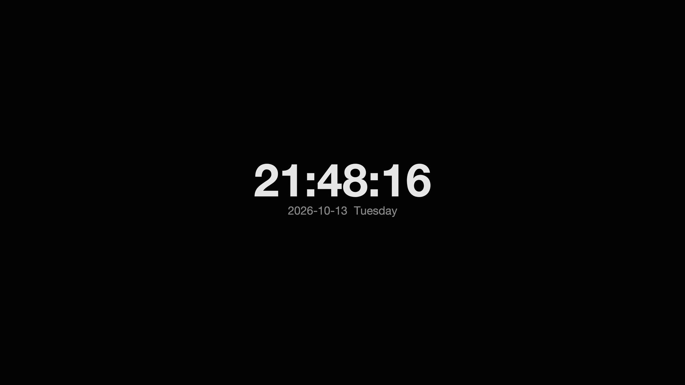

# fakesaver 🖥️

一个 macOS 上的**假屏幕保护程序**:系统并没有真的启动屏保,只是全屏显示一张图片(或时钟),看起来像屏保在运行。键鼠闲置后自动启动,动一下鼠标或按任意键立即退出——行为和真屏保完全一致。

> A fake screensaver for macOS: it doesn't trigger the real screensaver — it just covers every display with a fullscreen image (or a clock). Auto-starts after keyboard/mouse idle, and quits instantly on any input, exactly like a real screensaver.



## 特性

- 🖥️ **多屏全覆盖**:自动枚举所有显示器,每块屏幕独立全屏窗口(基于 CoreGraphics)
- ⏱️ **闲置自启**:看门狗进程监测键鼠闲置时间(默认 180 秒),超时自动启动
- 🖼️ **两种模式**:显示指定图片(等比缩放、黑边填充)或极简居中时钟
- 🏃 **一触即退**:移动鼠标 / 按任意键 / 点击,所有屏幕同时退出
- 🔧 **零第三方依赖**:只用 Python 标准库 + Pillow
- 🚀 **launchd 常驻**:登录自启,崩溃自动拉起

## 要求

- macOS
- Python 3.6+ 与 Pillow(`pip install Pillow`)
- ⚠️ 部分 macOS 版本上,系统自带 Python 的 Tk 会因版本检查直接崩溃(`macOS xx or later required` 弹"Python 意外退出")。`fakesaver.py` 内置了引导切换逻辑,可设置环境变量 `FAKESAVER_MANAGED_PY` 指向一个 Tk 正常的 Python 解释器实现自动切换。

## 快速开始

### 手动启动(一次性)

```bash
python3 fakesaver.py                  # 时钟模式
python3 fakesaver.py /path/to/img.png # 图片模式
```

退出:动一下鼠标或按任意键。

也可以直接双击 `启动假屏保.command`(macOS)。

### 闲置自动启动(常驻)

```bash
./install.sh        # 默认闲置 180 秒触发
./install.sh 300    # 自定义闲置秒数
```

安装后作为 launchd 服务 `com.local.fakesaver` 常驻运行,开机自启。日志在 `/tmp/fakesaver_watchdog.log`。

```bash
# 暂时停用
launchctl unload ~/Library/LaunchAgents/com.local.fakesaver.plist
# 彻底卸载
./uninstall.sh
```

## 文件说明

| 文件 | 作用 |
|---|---|
| `fakesaver.py` | 屏保本体:多屏全黑窗口 + 图片/时钟,监听输入退出 |
| `fakesaver_watchdog.py` | 看门狗:轮询键鼠闲置时间,超时拉起屏保 |
| `com.local.fakesaver.plist.template` | launchd 配置模板(`install.sh` 会自动填充路径) |
| `install.sh` / `uninstall.sh` | 一键安装 / 卸载常驻服务 |
| `启动假屏保.command` | macOS 双击启动器 |

## 原理

- **闲置检测**:`CGEventSourceSecondsSinceLastEventType`(CoreGraphics, ctypes 调用),统计键鼠任意输入事件
- **多屏枚举**:`CGGetActiveDisplayList` + `CGDisplayBounds` 获取每块显示器的全局坐标,先移动窗口到目标显示器再 `-fullscreen`,macOS 会为每块屏创建独立全屏 Space
- **退出**:绑定 `<Motion>`(带 15px 防抖阈值)/ `<Key>` / `<Button>`,任一窗口触发即销毁全部窗口

## License

MIT
